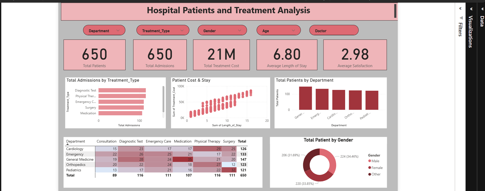

# 🏥 Hospital Patients & Treatment Analysis

An interactive **Power BI dashboard** designed to analyze hospital patient admissions, treatment costs, length of stay, departmental performance, and patient demographics. This project demonstrates data visualization and business intelligence skills using healthcare data.

## 📊 Project Overview

The objective of this project is to transform hospital data into meaningful insights that can help healthcare administrators understand patient trends, compare departments, monitor treatment expenses, and support data-driven decisions.

The dashboard provides an overview of patient activity through KPI cards, interactive filters, charts, and a department-wise treatment summary.

## 🎯 Project Objectives

- Analyze patient admissions across hospital departments.
- Compare treatment types and admission patterns.
- Explore treatment costs and length of hospital stay.
- Understand patient demographics by gender and age.
- Compare departmental performance using visual summaries.
- Build an interactive, professional, single-page Power BI dashboard.

## 🖥️ Dashboard Preview



*Dashboard created using Microsoft Power BI.*

## ✨ Key Dashboard Features

- **KPI Cards:** Overview of key hospital performance indicators.
- **Interactive Slicers:** Filter the report by available categories such as department, treatment, gender, age, and doctor, depending on the final data model.
- **Treatment Analysis:** Compare admissions across treatment categories.
- **Cost vs. Length of Stay:** Explore the relationship between treatment expenses and hospital stay duration.
- **Department Analysis:** Compare patient volumes across hospital departments.
- **Patient Demographics:** Visualize the distribution of patients by gender.
- **Department-Treatment Matrix:** Compare treatment counts across departments using a color-coded matrix.

## 🛠️ Tools & Technologies

- **Microsoft Power BI Desktop** — dashboard development and data visualization
- **CSV** — structured healthcare dataset
- **Power Query** — data import and transformation, where applicable
- **DAX** — calculated measures and KPIs, where applicable
- **GitHub** — project documentation, version control, and portfolio presentation

## 📁 Project Structure

```text
Hospital-Patients-Treatment-Analysis/
│
├── README.md
├── HospitalDashboard.pbix
├── Hospital_Patient_Treatment_Analytics_Dataset.csv
├── hospital-dashboard.png
```

## 📂 Dataset Information

The project includes a CSV dataset containing **2,000 records and 15 columns**.

The dataset includes the following fields:

| Column | Description |
|---|---|
| Patient_ID | Unique patient identifier |
| Age | Patient age |
| Age_Group | Patient age category |
| Gender | Patient gender |
| Blood_Group | Patient blood group |
| Diagnosis | Recorded diagnosis |
| Treatment | Treatment category |
| Department | Hospital department |
| Admission_Date | Date of admission |
| Discharge_Date | Date of discharge |
| Length_of_Stay | Duration of hospital stay |
| Admission_Type | Scheduled or emergency admission category |
| Insurance | Insurance category |
| Treatment_Cost | Recorded treatment cost |
| Outcome | Recorded patient outcome |


## 📈 Key Performance Indicators

The dashboard is designed to summarize important healthcare metrics, including:

- Total patients
- Total admissions
- Total treatment cost
- Average length of stay
- Average patient satisfaction, if satisfaction data is available

The exact KPI values depend on the dataset, filters, and calculations used in the final Power BI report.

## 🔍 Analytical Insights

The dashboard can help users investigate questions such as:

1. Which hospital departments handle the most patients?
2. Which treatment categories account for the most admissions?
3. How does treatment cost vary with length of stay?
4. How are patients distributed across demographic groups?
5. How do treatment patterns differ between departments?
6. Which departments or treatment categories may require further investigation?

Actual findings should be documented after validating the dashboard against the underlying dataset.

## 🚀 How to Run the Project

1. Download or clone this repository.
2. Install Microsoft Power BI Desktop.
3. Open `HospitalDashboard.pbix`.
4. If prompted, update the data source path to the downloaded CSV file.
5. Refresh the data and resolve any data-source or transformation errors.
6. Interact with the slicers and visualizations to explore the report.


## 📚 Skills Demonstrated

- Data analysis and interpretation
- Business intelligence and dashboard design
- Data visualization
- Data cleaning and transformation
- KPI reporting
- Healthcare data exploration
- Project documentation using Markdown
- GitHub repository management

## ⚠️ Data Disclaimer

This project is intended for educational and portfolio purposes. The dataset should be verified for its source, completeness, and suitability before drawing conclusions. Do not upload real patient-identifiable or confidential medical information to a public repository.

## 👨‍💻 Author

**Anushka chettiar**

B.Sc. Data Science Student

GitHub: (https://github.com/anushka7090)

---

⭐ If you find this project useful, feel free to explore the repository and share your feedback.
